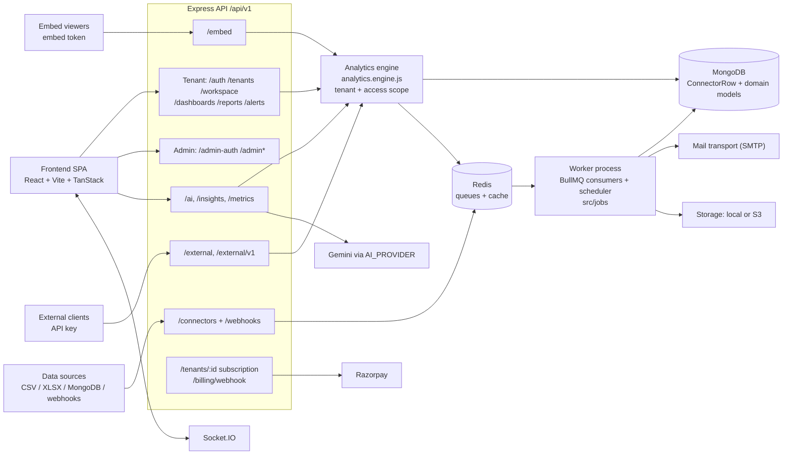

# Analivo

A multi-tenant SaaS analytics platform: workspaces connect data sources, query them through a tenant-scoped analytics engine, ask questions in natural language, and publish dashboards, reports, alerts, embeds and an external API.

The repository has two applications. `backend/` is a single Node.js (>= 20, ESM) service built on Express 5, MongoDB/Mongoose, BullMQ/Redis and Socket.IO. It runs as an HTTP process (`src/server.js`) and a worker process (`src/worker.js`). `frontend/` is a React single-page app built with Vite, TanStack Router and TanStack Query.

**Status:** under active development. Backend sprints 0 to 9 are recorded as complete in [backend/src/docs/STATUS.md](backend/src/docs/STATUS.md). See [backend/CHANGELOG.md](backend/CHANGELOG.md) for the entry-by-entry record. Known gaps are listed under [Limits and next steps](#limits-and-next-steps).

## Why build it

From [backend/src/docs/02-project-vision.md](backend/src/docs/02-project-vision.md): the platform gives every customer company its own isolated workspace. In that workspace the company connects data sources, builds dashboards, shares reports and embeds widgets outside the platform. The platform operator gets a single admin view across all tenants.

**In scope:** tenant and admin portals served by one backend (RBAC tells them apart), data connectors and webhooks, an analytics engine, dashboards and widgets, scheduled reports, alerts, notifications, governance and audit, billing and entitlements, embeds, an external API with API keys, and AI-assisted Ask and insights.

**Out of scope today:** joins or relationships across datasets, drag-and-drop dashboard layout, and performance benchmarking (see [Limits](#limits-and-next-steps)).

## System architecture



Mount paths come from [backend/src/routes/index.js](backend/src/routes/index.js). Queues are in [backend/src/queues](backend/src/queues), jobs in [backend/src/jobs](backend/src/jobs), and the Socket.IO server in [backend/src/websocket](backend/src/websocket). The provider adapters are [aiProvider.adapter.js](backend/src/services/aiProvider.adapter.js), [paymentProvider.adapter.js](backend/src/services/paymentProvider.adapter.js), [mail.transport.js](backend/src/services/mail.transport.js) and [storage.service.js](backend/src/services/storage.service.js).

## Main data flows

1. **Connect a source.** A source is created through `/connectors`, which uses [connector.service.js](backend/src/services/connector.service.js) and the connector registry in [backend/src/connectors](backend/src/connectors). Connector configuration is encrypted (`ENCRYPTION_KEY`, `CONNECTOR_ENCRYPTION_PURPOSE`). Webhook sources push data to `/webhooks`.
2. **Sync.** A sync job goes onto the connector queue ([connector.queue.js](backend/src/queues/connector.queue.js)). Retries use `CONNECTOR_QUEUE_ATTEMPTS` (default 5) with backoff `CONNECTOR_QUEUE_BACKOFF_MS`. Each sync holds a lease (`CONNECTOR_SYNC_LEASE_MS`), and stale jobs are recovered by [stale-job-recovery.job.js](backend/src/jobs/stale-job-recovery.job.js), with recovery bounded by `CONNECTOR_SYNC_MAX_RECOVERIES`.
3. **Sanitize.** Rows are stored in the ConnectorRow collection. Sensitive keys are removed at ingestion and again at query time by [sensitiveFields.js](backend/src/utils/sensitiveFields.js) (`isSensitiveFieldName`, `stripSensitiveFields`, `sensitiveKeysIn`).
4. **Profile.** Dataset schemas are profiled by [datasetSchema.service.js](backend/src/services/datasetSchema.service.js).
5. **Query.** Queries run through [analytics.engine.js](backend/src/services/analytics.engine.js). It validates the public query and injects `tenantId` and the resolved row-level `access` scope as internal keys that clients cannot send. Per-tenant concurrency is limited by [analytics.limiter.js](backend/src/services/analytics.limiter.js), and results are cached by [analytics.cache.js](backend/src/services/analytics.cache.js).
6. **Ask.** Natural-language questions go through [backend/src/services/ai](backend/src/services/ai) in this order:
   1. `gate.js` checks the kill switch, the provider, the plan entitlement, recorded consent and the daily quota.
   2. `context.js` builds the dataset context.
   3. `planner.js` produces a query plan with the LLM.
   4. `validator.js` validates the plan against the engine rules.
   5. `visualization.js` picks a chart.
   6. `ask.service.js` coordinates these steps.
7. **Dashboards and widgets.** Handled by [dashboard.service.js](backend/src/services/dashboard.service.js). Publishing calls `assertPublishable`.
8. **Reports and alerts.** Handled by [report.service.js](backend/src/services/report.service.js) and [alert.service.js](backend/src/services/alert.service.js). They are driven by [reportSchedule.job.js](backend/src/jobs/reportSchedule.job.js), [alertEval.job.js](backend/src/jobs/alertEval.job.js) and [deliveryRetry.job.js](backend/src/jobs/deliveryRetry.job.js).
9. **Distribution.** Published dashboards are served through embeds ([embed.service.js](backend/src/services/embed.service.js)). Programmatic access goes through the external API ([externalApi.service.js](backend/src/services/externalApi.service.js)).
10. **Billing.** Plans and limits are managed by [subscription.service.js](backend/src/services/subscription.service.js), the `billing*.service.js` files and [entitlement.service.js](backend/src/services/entitlement.service.js). Routes are gated by [requireFeature.middleware.js](backend/src/middleware/requireFeature.middleware.js). Lifecycle and reconciliation jobs are [billingLifecycle.job.js](backend/src/jobs/billingLifecycle.job.js) and [billingReconcile.job.js](backend/src/jobs/billingReconcile.job.js).

**Failure paths.** Failed queue jobs retry with backoff. Outbound deliveries are retried by `deliveryRetry.job.js`. When the queue is saturated, analytics queries wait up to `ANALYTICS_QUERY_QUEUE_TIMEOUT_MS` and are then rejected. When the AI gate refuses a request, the response carries a `reason` (for example `AI_DISABLED`, `FEATURE_NOT_AVAILABLE`, `AI_CONSENT_REQUIRED`) and an `action`.

## Verification status

There are no performance benchmarks in this repository. Verification consists of:

- **Backend test suite:** `npm test`, which runs [run-tests.js](backend/scripts/ci/run-tests.js) against `mongodb-memory-server`. Tests are in [backend/tests](backend/tests).
- **CI guards:** `npm run ci:guards`, which runs [run-all.js](backend/scripts/ci/run-all.js). The guards check stubs, routes, models, config and README sync.
- **Evaluation scripts:** `npm run ai:eval` ([ai-eval.js](backend/scripts/ci/ai-eval.js)) and `npm run insights:eval` ([insights-eval.js](backend/scripts/ci/insights-eval.js)).
- **Frontend checks:** `npm test` (vitest), `npm run typecheck`, `npm run lint` and `npm run build`.

[backend/AI_CONTEXT.md](backend/AI_CONTEXT.md) records "561 passing backend tests, 5/5 CI guards" (dated 2026-10-15). That number was saved by an earlier run. It was not re-run while writing this README.

If the cached mongod 8.2.6 binary used by `mongodb-memory-server` is corrupt, run the suite with `MONGOMS_VERSION=6.0.14 npm test`. This local workaround was observed on 2026-10-24.

## Architecture layers

### 1. API and middleware

**What it does:** mounts every router under `API_PREFIX` (default `/api/v1`) and applies authentication, tenant isolation, RBAC, rate limits, audit and validation.

| Concern | Path |
| --- | --- |
| Route aggregator | `backend/src/routes/index.js` |
| Tenant isolation | `backend/src/middleware/tenantIsolation.middleware.js`, `tenant.middleware.js` |
| RBAC / permissions | `backend/src/middleware/rbac.middleware.js`, `permission.middleware.js`, `modulePermission.middleware.js` |
| API keys | `backend/src/middleware/apiKeyAuth.middleware.js` |
| Plan gating | `backend/src/middleware/requireFeature.middleware.js` |
| Step-up / idempotency | `stepUp.middleware.js`, `idempotency.middleware.js` |

**Key decision:** the admin and tenant portals share one backend, and RBAC tells them apart (see [DECISIONS.md](backend/src/docs/DECISIONS.md) and [adr/](backend/src/docs/adr)).

### 2. Connectors and ingestion

**What it does:** stores connector configuration, runs syncs through the queue, sanitizes rows and profiles dataset schemas.

| Concern | Path |
| --- | --- |
| Service | `backend/src/services/connector.service.js` |
| Registry | `backend/src/connectors/` |
| Queue | `backend/src/queues/connector.queue.js` |
| Sanitization | `backend/src/utils/sensitiveFields.js` |
| Schema profiling | `backend/src/services/datasetSchema.service.js` |

**Key decisions:**
- Upload sizes are capped (`CONNECTOR_CSV_MAX_UPLOAD_MB`, `CONNECTOR_XLSX_MAX_UPLOAD_MB`).
- Rows per sync are capped (`CONNECTOR_MAX_ROWS_PER_SYNC`).
- Private-network egress is blocked in production (`CONNECTOR_ALLOW_PRIVATE_NETWORKS` defaults to off in production).

### 3. Analytics engine

**What it does:** validates queries and runs them against ConnectorRow data, scoped to the tenant and the user's row-level access.

| Concern | Path |
| --- | --- |
| Query model and execution | `backend/src/services/analytics.engine.js` |
| Concurrency limiter | `backend/src/services/analytics.limiter.js` |
| Cache | `backend/src/services/analytics.cache.js` |
| Row-level access | `backend/src/services/dataAccess.service.js`, `backend/src/middleware/dataAccess.middleware.js` |

**Key decision:** `tenantId`, `access`, `timezone` and `now` are internal keys. A client cannot supply them, so a filter cannot widen the scope.

### 4. AI (Ask, insights, metric catalogue)

**What it does:** turns natural-language questions into validated engine queries and produces the insights feed.

| Concern | Path |
| --- | --- |
| Gate | `backend/src/services/ai/gate.js` |
| Context / planner / validator | `backend/src/services/ai/context.js`, `planner.js`, `validator.js` |
| Visualization | `backend/src/services/ai/visualization.js` |
| Provider adapter | `backend/src/services/aiProvider.adapter.js` |
| Insights | `backend/src/services/insights/` |

**Key decisions:**
- The default `AI_PROVIDER` is `noop`. Ask stays unavailable until a provider is configured.
- LLM output is only a plan. It is validated before the engine runs it.

### 5. Dashboards, reports, alerts, delivery

**What it does:** manages dashboards and widgets, scheduled reports, alert evaluation and outbound delivery.

| Concern | Path |
| --- | --- |
| Dashboards | `backend/src/services/dashboard.service.js` |
| Reports | `backend/src/services/report.service.js`, `backend/src/jobs/reportSchedule.job.js` |
| Alerts | `backend/src/services/alert.service.js`, `backend/src/jobs/alertEval.job.js` |
| Delivery | `backend/src/services/delivery/`, `backend/src/jobs/deliveryRetry.job.js` |
| Frontend widget rendering | `frontend/src/components/common/WidgetView.tsx` |

### 6. Distribution: embed and external API

**What it does:** serves published dashboards to outside viewers and exposes data to API-key clients.

| Concern | Path |
| --- | --- |
| Embed | `backend/src/services/embed.service.js`, `backend/src/routes/embed.routes.js` |
| External API | `backend/src/services/externalApi.service.js`, `backend/src/routes/externalApi.routes.js` |
| OpenAPI spec | `backend/src/openapi/externalApi.spec.js` |
| API keys | `backend/src/services/apiKey.service.js`, `apiKeyUsage.service.js` |

### 7. Billing and entitlements

**What it does:** tracks plans and subscriptions, resolves which features each tenant may use, and processes payments.

| Concern | Path |
| --- | --- |
| Subscriptions | `backend/src/services/subscription.service.js` |
| Billing | `backend/src/services/billing.service.js`, `billingWebhook.service.js`, `billingLifecycle.service.js`, `billingReconcile.service.js`, `billingPricing.service.js` |
| Entitlements | `backend/src/services/entitlement.service.js`, `entitlementOverride.service.js` |
| Payment provider | `backend/src/services/paymentProvider.adapter.js` (Razorpay) |

### 8. Frontend SPA

**What it does:** the tenant and admin user interface.

| Concern | Path |
| --- | --- |
| API client | `frontend/src/lib/api/client.ts` |
| Session | `frontend/src/lib/auth/session.tsx` |
| Routes | `frontend/src/routes/`, `frontend/src/router.tsx` |
| Features | `frontend/src/features/` |

### Problems discovered and how they were addressed (2026-10-24)

| Problem | Fix | Where |
| --- | --- | --- |
| Session was cleared on 401 responses that were stale or unrelated to auth | The client now clears the session only on genuine auth failures | `frontend/src/lib/api/client.ts`, `frontend/src/lib/auth/session.tsx` |
| Raw analytics rows rendered as dashes | Cell values are resolved and rows flattened (`cellValue`, `flattenRow`) | `frontend/src/components/common/WidgetView.tsx` |
| Ask gate ignored the plan and returned opaque refusals | The gate uses the plan entitlement as the authority and returns `reason` and `action` | `backend/src/services/ai/gate.js` |
| Sensitive fields could reach storage and results | Denylist stripping at ingestion and at query time | `backend/src/utils/sensitiveFields.js` |
| Broken dashboards could be published | `assertPublishable` validation before publish and embed | `backend/src/services/dashboard.service.js` |
| MongoDB test-connection did not actually connect | The test now opens a real connection | `backend/src/services/connector.service.js` |
| Alerts re-fired on every evaluation | `repeatMode`: `once_per_incident` (default) or `after_cooldown` | `backend/src/services/alert.service.js` |

## Configuration and core algorithms

**Analytics query model.** The public keys are `connectorIds`, `filters`, `filtersOp`, `dateRange`, `metrics`, `groupBy`, `orderBy` and `pagination`. Limits from `LIMITS` in `analytics.engine.js`:

| Limit | Value |
| --- | --- |
| Connectors per query | 50 |
| Filters | 50 |
| `in` values | 1000 |
| Metrics | 20 |
| `groupBy` fields | 5 |
| `orderBy` fields | 5 |
| Page size (`maxLimit`) | 200 |
| Maximum page | 100000 |

Date presets: `today`, `yesterday`, `last_7_days`, `last_30_days`, `this_month`, `last_month`, `previous_month`, `this_quarter`, `last_quarter`, `this_year`, `last_year`, `custom`. Relative presets are resolved in the tenant's timezone.

In a grouped query, `orderBy` must reference a `groupBy` field or a metric alias. The `compare` option cannot be combined with a bucketed `groupBy`. Query execution is bounded by these settings:

| Setting | Default |
| --- | --- |
| `ANALYTICS_QUERY_TIMEOUT_MS` | 15000 |
| `ANALYTICS_MAX_CONCURRENT_QUERIES_PER_TENANT` | 4 |
| `ANALYTICS_MAX_QUEUED_QUERIES_PER_TENANT` | 16 |

**Entitlement resolution.** `entitlement.service.js` resolves features from the tenant's plan and subscription, plus per-tenant overrides in `entitlementOverride.service.js`. `requireFeature` rejects requests for features the tenant is not entitled to.

**AI planning and validation.** The gate runs its checks in this order: kill switch, provider configured, plan entitlement, consent, and then the daily quota. The quota is consumed last, so a refused request never uses quota. The context is capped at 20 datasets and 20000 characters. The planner output goes through `validator.js` before execution.

**Alert evaluation.** An alert fires when its threshold condition holds and either it has never triggered or `cooldownMinutes` (default 60) have passed since the last trigger. `repeatMode` controls whether it re-fires while the incident continues.

## Setup and installation

Requirements:
- Node.js >= 20. The Docker image uses `node:22-alpine`.
- MongoDB. docker-compose uses `mongo:7`.
- Optionally, Redis. Without `REDIS_URL`, the in-memory queue in `backend/src/queues/memory.queue.js` is available.

```bash
cd backend && npm install
cp .env.example .env          # then fill in values
cd ../frontend && npm install
cp .env.example .env
```

### Backend environment variables (selected; all read in `backend/src/config/env.js`)

| Variable | Purpose | Default | Required |
| --- | --- | --- | --- |
| `NODE_ENV` | `development` / `production` / `test` | `development` | |
| `PORT` | HTTP port | `8080` | |
| `API_PREFIX` | Route prefix | `/api/v1` | |
| `PROCESS_ROLE` | `web`, `worker` or `all` | `all` | |
| `MONGODB_URI` | Database connection | `mongodb://127.0.0.1:27017/saas_analytics` | in practice |
| `REDIS_URL` | Queues and cache. Redis is enabled when this is set | empty | |
| `JWT_SECRET` | Token signing | dev-only default | yes in production |
| `JWT_ACCESS_TTL` / `JWT_REFRESH_TTL` | Token lifetimes | `15m` / `30d` | |
| `PASSWORD_KDF` | `argon2` or `scrypt` | `argon2` | |
| `CLIENT_URL` / `CORS_ORIGINS` | Frontend origin and CORS allow-list | `http://localhost:3000` | |
| `COOKIE_SECURE` / `AUTH_COOKIE_SAMESITE` | Session cookie | `true` and `None` in production | |
| `ENCRYPTION_KEY` | Encrypts connector config and secrets | empty | for connectors |
| `MAIL_PROVIDER`, `SMTP_HOST`, `SMTP_PORT`, `MAIL_USER`, `MAIL_PASSWORD`, `MAIL_FROM` | Mail transport | `smtp`, empty, `587` | `MAIL_PASSWORD` is required in production when `SMTP_HOST` is set |
| `STORAGE_PROVIDER` | `local` or `s3` | `local` | |
| `S3_BUCKET`, `S3_REGION`, `S3_ENDPOINT`, `S3_ACCESS_KEY_ID`, `S3_SECRET_ACCESS_KEY` | S3 storage | empty, `us-east-1` | when `STORAGE_PROVIDER=s3` |
| `AI_PROVIDER`, `AI_MODEL`, `AI_API_KEY` | AI provider | `noop`, `gemini-2.5-flash`, empty | for Ask |
| `RAZORPAY_ENABLED`, `RAZORPAY_KEY_ID`, `RAZORPAY_KEY_SECRET`, `RAZORPAY_WEBHOOK_SECRET`, `RAZORPAY_ENVIRONMENT`, `RAZORPAY_PLAN_MAPPING_JSON` | Payments | `false`, empty, `test` | for paid billing |
| `METRICS_TOKEN` | Bearer token for `/metrics` | empty | |
| `EMBED_TOKEN_DEFAULT_TTL_SEC` / `EMBED_TOKEN_MAX_TTL_SEC` | Embed token lifetime | 86400 / 604800 | |
| `CONNECTOR_QUEUE_ATTEMPTS` / `CONNECTOR_QUEUE_BACKOFF_MS` | Sync retries | `5` / `2000` | |

See [backend/docs/ANALIVO_ENVIRONMENT_VARIABLE_AUDIT.md](backend/docs/ANALIVO_ENVIRONMENT_VARIABLE_AUDIT.md) and `backend/.env.example` for the full list.

### Frontend environment variables

| Variable | Purpose | Default |
| --- | --- | --- |
| `VITE_API_BASE_URL` | Backend origin | unset (resolved in `client.ts`) |
| `VITE_API_PREFIX` | API prefix | `/api/v1` |

See [frontend/VERCEL.md](frontend/VERCEL.md) for deployment.

## Quick start

```bash
# terminal 1 - API (nodemon)
cd backend && npm run dev
# terminal 2 - worker (only needed when the API runs with PROCESS_ROLE=web)
cd backend && npm run start:worker
# one-off - create the first platform admin
cd backend && npm run bootstrap:admin
# terminal 3 - SPA
cd frontend && npm run dev
```

With the default `PROCESS_ROLE=all`, the API process also runs the queue consumers and the scheduler, so a separate worker is optional in development.

## API reference

All paths are relative to `API_PREFIX` (`/api/v1`).

| Group | Mount | Auth |
| --- | --- | --- |
| Health | `/health`, `/health/ready` | public |
| Tenant auth | `/auth` | public, then session |
| Workspace | `/tenants/:id`, `/workspace/*`, `/users`, `/roles`, `/permissions`, `/invitations`, `/access-requests`, `/data-access` | tenant JWT + RBAC |
| Connectors | `/connectors`, `/webhooks` | tenant JWT; webhook keys |
| Analytics | `/analytics` | tenant JWT |
| Dashboards / reports / alerts | `/dashboards`, `/reports`, `/alerts`, `/delivery`, `/notifications` | tenant JWT |
| AI | `/ai`, `/insights`, `/metrics` (catalogue) | tenant JWT + entitlement |
| Embed | `/embed` | embed token |
| External API | `/external/v1` (and the legacy `/external`), `/api-keys` | API key; JWT for key management |
| Files / exports | `/files`, `/data-exports`, `/workspace/data-exports` | signed token / JWT |
| Admin | `/admin-auth`, `/admin`, `/admin/dashboard`, `/admin/plans`, `/admin/subscriptions`, `/admin/entitlements`, `/admin/security-alerts`, `/admin/tenant-deletions`, `/tenants` | admin JWT |
| Governance | `/audit-logs`, `/access-logs`, `/compliance`, `/monitoring`, `/support`, `/support-session`, `/settings`, `/feature-flags`, `/master-data`, `/email-templates` | JWT + RBAC |
| Billing webhook | `/billing/webhook` | provider signature |
| Observability | `/metrics` (with `METRICS_TOKEN`), `/status`, `/client-errors` | token / public |

The OpenAPI spec for the external API is [backend/src/openapi/externalApi.spec.js](backend/src/openapi/externalApi.spec.js). For a full endpoint inventory, see [backend/docs/BACKEND_API_INVENTORY.md](backend/docs/BACKEND_API_INVENTORY.md).

## Operations

- **Docker:** [backend/Dockerfile](backend/Dockerfile) builds a multi-stage, non-root image on port 8080, with a healthcheck on `/api/v1/health`. [backend/docker-compose.yml](backend/docker-compose.yml) starts MongoDB and the API (`docker compose up --build`).
- **Health:** `/health` is the liveness check and `/health/ready` the readiness check ([health.routes.js](backend/src/routes/health.routes.js)).
- **Observability:** `/metrics` and `/status` ([observability.routes.js](backend/src/routes/observability.routes.js)).
- **Worker:** `npm run start:worker`. Set `PROCESS_ROLE=web` on the API processes.
- **Maintenance scripts** (in `backend/scripts/ci/`):

  | Script | Purpose |
  | --- | --- |
  | `npm run db:retention` | Data retention |
  | `npm run db:indexes` | Sync indexes |
  | `npm run db:permissions` | Seed permissions |
  | `npm run db:restore-drill` | Restore drill |
  | `npm run db:report-sensitive-rows` | Report rows that still hold sensitive keys |

- **Runbook:** [backend/docs/PRODUCTION_DEPLOYMENT_RUNBOOK.md](backend/docs/PRODUCTION_DEPLOYMENT_RUNBOOK.md).

## Tests

```bash
# backend
cd backend
npm test                      # MONGOMS_VERSION=6.0.14 npm test if the cached mongod is corrupt
npm run test:argon2           # suite with the argon2 KDF
npm run ci:guards

# frontend
cd frontend
npm test                      # vitest run
npm run typecheck             # tsc --noEmit
npm run lint                  # eslint .
npm run build                 # vite build
```

## Repository map

| Path | Contents |
| --- | --- |
| `backend/src/server.js`, `backend/src/worker.js` | HTTP and worker entry points |
| `backend/src/app.js` | Express app |
| `backend/src/routes/` | Routers |
| `backend/src/controllers/`, `backend/src/modules/`, `backend/src/validators/` | Handlers and validation |
| `backend/src/services/` | Business logic, including `ai/`, `insights/` and `delivery/` |
| `backend/src/models/`, `backend/src/repositories/` | Mongoose models and data access |
| `backend/src/middleware/` | Auth, tenant isolation, RBAC, limits |
| `backend/src/connectors/` | Connector registry |
| `backend/src/jobs/`, `backend/src/queues/` | Background jobs and queues |
| `backend/src/websocket/` | Socket.IO |
| `backend/src/config/` | Env, database, logger, mail, socket |
| `backend/src/docs/`, `backend/docs/` | Architecture and audit documents |
| `backend/scripts/ci/` | Test runner, CI guards, migrations, evaluations |
| `backend/tests/` | Backend tests |
| `frontend/src/` | SPA: `routes/`, `features/`, `components/`, `lib/` |

## Security and privacy

- **Tenant isolation:** `tenantIsolation.middleware.js`. In addition, the analytics engine injects `tenantId` and the row-level `access` scope itself.
- **RBAC:** `rbac.middleware.js`, `permission.middleware.js` and `modulePermission.middleware.js`. Admin scoping is in `adminScope.middleware.js`, and step-up auth for sensitive actions in `stepUp.middleware.js`.
- **Encrypted connector configuration:** `ENCRYPTION_KEY`, with `aes-256-gcm` by default and a key version.
- **Sensitive-field denylist:** `backend/src/utils/sensitiveFields.js`, applied at ingestion and at query time.
- **API keys:** tenant-scoped keys checked by `apiKeyAuth.middleware.js`. Usage is tracked in `apiKeyUsage.service.js`, and rate limits are in `rateLimiter.middleware.js`.
- **Embed tokens:** issued only for published dashboards (`assertPublishable`). Lifetime is short and capped by `EMBED_TOKEN_MAX_TTL_SEC`. There is a per-dashboard cap (`EMBED_MAX_PER_DASHBOARD`) and a rate limit. Tokens can be revoked through `embed.service.js`.
- **AI consent:** Ask refuses with `AI_CONSENT_REQUIRED` until the workspace has granted consent.
- **Audit logging:** `audit.middleware.js` and `auditLog.service.js`, plus a hash chain (`auditChain.service.js`) that `scripts/ci/verify-audit-chain.js` verifies.

See [backend/docs/ANALIVO_SECURITY_GAP_ANALYSIS.md](backend/docs/ANALIVO_SECURITY_GAP_ANALYSIS.md) for open items.

## Limits and next steps

- Ask context is trimmed to the first 20 datasets, with no relevance ranking.
- The MongoDB connector syncs one collection per connector.
- Schema discovery works only on saved connectors.
- There are no relationships or joins across datasets.
- Sensitive keys are stripped from analytics results in Node after the fetch, not in the database query.
- Widgets cannot be dragged or resized.
- The metric filters editor takes free-text column names.
- In at least one tenant, rows ingested earlier still contain sensitive keys at rest. They are hidden at query time. A resync or an approved cleanup is needed (`npm run db:report-sensitive-rows` reports them).
- Payments require Razorpay configuration (`RAZORPAY_*`).
- AI requires `AI_PROVIDER=gemini` and `AI_API_KEY`.
- There are no performance benchmarks.

## Documentation

| Document | Contents |
| --- | --- |
| [backend/README.md](backend/README.md) | Backend overview |
| [backend/AI_CONTEXT.md](backend/AI_CONTEXT.md) | Saved project context and baseline |
| [backend/CHANGELOG.md](backend/CHANGELOG.md) | Change history |
| [backend/src/docs/README.md](backend/src/docs/README.md) | Docs index |
| [backend/src/docs/ARCHITECTURE.md](backend/src/docs/ARCHITECTURE.md) | Architecture |
| [backend/src/docs/STATUS.md](backend/src/docs/STATUS.md) | Implementation status |
| [backend/src/docs/DECISIONS.md](backend/src/docs/DECISIONS.md), [adr/](backend/src/docs/adr) | Decisions |
| [backend/src/docs/02-project-vision.md](backend/src/docs/02-project-vision.md) | Vision |
| [backend/docs/](backend/docs) | Audits, phase reports, runbooks |
| [backend/docs/RAZORPAY_CONFIGURATION_GUIDE.md](backend/docs/RAZORPAY_CONFIGURATION_GUIDE.md) | Payments setup |
| [frontend/README.md](frontend/README.md) | Frontend overview |
| [frontend/VERCEL.md](frontend/VERCEL.md) | Frontend deployment |
| [frontend/AGENTS.md](frontend/AGENTS.md) | Frontend contributor notes |
