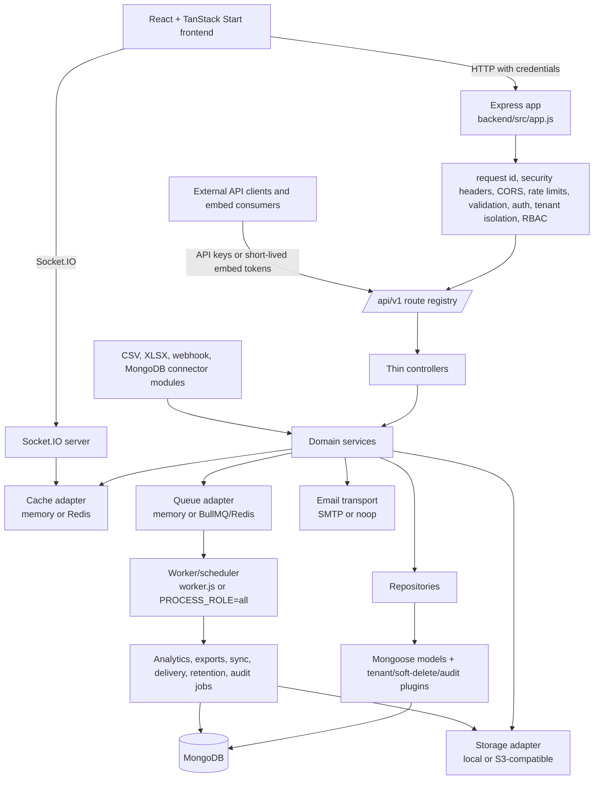

# Analivo SaaS Analytics Platform

**A multi-tenant analytics application with a React/TanStack frontend and a Node.js/Express backend for ingesting data, querying tenant-scoped records, building dashboards, sharing/embedding results, and operating the surrounding identity, billing, governance, and support workflows.**

This repository contains two independently runnable applications:

- `backend/`: the versioned `/api/v1` HTTP API, Socket.IO server, MongoDB data layer, background jobs, connectors, exports, and operational controls.
- `frontend/`: the React 19/TanStack Start web application for tenant and platform-admin portals.

The implementation is broad but not presented as production-ready by this README. The repository's [same-day readiness report](backend/docs/PRODUCTION_READINESS_FINAL_REPORT.md) records a **blocked** status and still identifies deployment, legal, and complete backend-matrix work. Local verification performed while writing this README found the current frontend typecheck, lint, 131-file/757-test suite, and production build passing; lint emitted nine non-fatal React Fast Refresh warnings. Older sprint/status documents contain historical "green" claims; where they conflict with the readiness report or current execution, this README calls out the uncertainty.

## Why build it?

Teams need to move from operational data to repeatable analytics without giving every customer direct database access. Analivo addresses that workflow by combining connector ingestion, tenant-scoped analytics, dashboard authoring, scheduled reports and alerts, external API keys, and public embedding behind one permissioned platform.

The difficult parts are not only rendering charts. The backend must preserve tenant boundaries across authentication, queries, exports, jobs, dashboards, and support access; make retries safe; bound expensive analytics and artifact generation; and retain enough audit and operational context to diagnose failures. The design therefore favors explicit middleware boundaries, service/repository separation, centralized configuration, cache/queue/storage adapters, and fail-closed authorization.

The repository deliberately does not establish that every external integration or operational safeguard is production-complete. In particular, the readiness report identifies unresolved CI, legal-content, secret/provider, and deployment-validation work.

## System architecture



`backend/src/server.js` owns HTTP process lifecycle and graceful shutdown. `backend/src/worker.js` runs queue consumers and scheduled work without serving HTTP. `backend/src/app.js` is intentionally testable: it assembles middleware and routes but does not listen or connect to MongoDB.

### Main data flows

1. A browser or integration calls the versioned API. The frontend defaults to `http://localhost:8080` and `/api/v1`; deployment values are supplied through `VITE_API_BASE_URL` and `VITE_API_PREFIX`.
2. Global middleware adds request context, security headers, CORS, body limits, logging, metrics/signals, and rate limiting. Feature routes then authenticate the actor, resolve the tenant, enforce tenant isolation and permissions, validate input, and apply idempotency/audit behavior where required.
3. Controllers delegate to services. Services apply domain rules and use repositories for Mongoose access plus cache, queue, storage, encryption, or email adapters.
4. Connector providers ingest bounded data into tenant-scoped connector rows. The analytics engine filters, aggregates, groups, paginates, and projects those rows; dashboards and reports execute through the same analytics contracts.
5. Expensive or delayed work is enqueued for workers. With `REDIS_URL`, Redis-backed BullMQ/cache/adapters support multi-process deployment; without it, in-memory implementations are development/test fallbacks.
6. Results are returned as API responses, streamed/exported as artifacts, delivered through configured channels, or exposed to external consumers through scoped API keys and token-gated published embeds.

## Product capabilities and implementation status

The source contains substantial implementations for the following areas:

| Area | Evidence in repository | Status caveat |
| --- | --- | --- |
| Authentication and sessions | `backend/src/routes/auth.routes.js`, `backend/src/services/auth.service.js`, `frontend/src/features/auth/` | Implemented and heavily tested; deployment configuration still matters. |
| Platform admin, IAM, RBAC, multi-tenancy | `backend/src/middleware/`, `backend/src/services/`, `backend/src/models/`, `frontend/src/features/admin/` | Implemented surfaces; object-level authorization and contract gaps remain audit concerns. |
| Connectors and ingestion | `backend/src/modules/connectors/`, `backend/src/routes/connector.routes.js` | CSV/XLSX, webhook, and MongoDB paths exist; external-source and operational validation must be verified in deployment. |
| Analytics and master data | `backend/src/modules/analytics/`, `backend/src/routes/analytics.routes.js` | Tenant-scoped query engine and history/export flows are present. |
| Dashboards, widgets, reports, alerts, notifications | `backend/src/routes/dashboard.routes.js`, `report.routes.js`, `alert.routes.js`, `delivery.routes.js` | Code and tests exist; scheduled/external delivery depends on configured workers and providers. |
| API keys and embedding | `backend/src/routes/api-key.routes.js`, `externalApi.routes.js`, `embed.routes.js` | Scoped API-key and token-gated embed surfaces exist. |
| Billing and entitlements | `backend/src/routes/subscription.routes.js`, `admin-plan.routes.js`, `billing-webhook.routes.js` | Provider configuration and end-to-end production verification are not established by this repository alone. |
| Governance and operations | audit/access logs, compliance, monitoring, support, retention, export modules | Implemented controls exist; production readiness report still requires operational/legal validation. |
| AI ask/insights | `backend/src/routes/ai.routes.js`, `backend/src/services/aiProvider.adapter.js` | `AI_PROVIDER=noop` disables provider-backed ask by default; enablement requires server-side credentials and focused verification. |

## Architecture and implementation layers

### Layer 1: Web and API entry points

| Component | Responsibility | Implementation |
| --- | --- | --- |
| TanStack Start/Vite | Browser application, routing, server middleware, build | [`frontend/src/router.tsx`](frontend/src/router.tsx), [`frontend/src/start.ts`](frontend/src/start.ts) |
| Express application | Middleware order, API mounting, error boundary | [`backend/src/app.js`](backend/src/app.js) |
| HTTP/worker bootstrap | Listening, database startup, background work, shutdown | [`backend/src/server.js`](backend/src/server.js), [`backend/src/worker.js`](backend/src/worker.js) |

The frontend is feature-organized under `frontend/src/features/` and route-organized under `frontend/src/routes/`. The backend mounts route modules in one registry under [`backend/src/routes/index.js`](backend/src/routes/index.js), normally at `/api/v1`.

### Layer 2: Identity, tenant isolation, and authorization

Authentication uses separate tenant and admin session surfaces, JWT-backed access/refresh behavior, cookies, MFA paths, lockout/rate limits, and password KDF selection (`argon2` in normal operation, `scrypt` for portable tests). Middleware resolves the actor and tenant before services run. RBAC and permission checks are applied before mutations; tenant-scoped models and query plugins provide a second boundary in persistence.

Relevant code includes [`backend/src/middleware/auth.middleware.js`](backend/src/middleware/auth.middleware.js), [`backend/src/middleware/tenant.middleware.js`](backend/src/middleware/tenant.middleware.js), [`backend/src/middleware/rbac.middleware.js`](backend/src/middleware/rbac.middleware.js), [`backend/src/models/plugins/`](backend/src/models/plugins/), and [`frontend/src/lib/permissions/`](frontend/src/lib/permissions/).

### Layer 3: Domain services and persistence

Controllers are thin. Services own business decisions, repositories own Mongoose queries, and models define schemas and hooks. Shared plugins provide tenant scoping, soft deletion, pagination, optimistic concurrency, and audit events. MongoDB is the system of record; the default local URI is `mongodb://127.0.0.1:27017/saas_analytics`.

### Layer 4: Data ingestion and analytics

Connector modules validate and normalize CSV/XLSX/webhook/MongoDB inputs, protect connector secrets with encryption, enforce row/size/time limits, and hand work to the sync engine and queue. The analytics engine operates on ingested rows with filters, aggregations, grouping/date handling, projections, pagination, caching, and per-tenant concurrency limits. Dashboard widgets and reports reuse these contracts rather than maintaining separate query semantics.

### Layer 5: Background work and integrations

Background work covers connector syncs, analytics/report generation, artifact exports, email outbox processing, delivery retries, retention, audit consumption, security detection, and scheduled alerts/reports. `PROCESS_ROLE=all` is the development default; production topologies can split `web` and `worker`, but `PROCESS_ROLE=web` requires Redis. Storage is local by default or S3-compatible when configured; email uses SMTP or the configured noop/capture behavior in tests.

### Layer 6: Governance and observability

Request IDs, structured Pino logging, redaction, access/audit logs, security signals, health/readiness/status endpoints, metrics, error reporting, retention jobs, support-session auditing, and export/download controls are implemented across middleware and services. These controls reduce operational risk but are not a substitute for deployment-specific validation, key management, legal approval, backups, or incident exercises.

## Configuration

Backend configuration is centralized in [`backend/src/config/env.js`](backend/src/config/env.js). Start from [`backend/.env.example`](backend/.env.example); do not commit `.env` or real credentials.

| Variable | Purpose | Default / requirement |
| --- | --- | --- |
| `NODE_ENV` | Runtime mode | `development`; production requires validated secrets. |
| `PORT` | Backend listen port | `8080` |
| `MONGODB_URI` | MongoDB connection | Local MongoDB URI shown above. |
| `JWT_SECRET` | JWT signing | Development fallback only; required and non-default in production. |
| `CLIENT_URL`, `CORS_ORIGINS` | Browser CORS policy | Client URL defaults to `http://localhost:3000`. |
| `PROCESS_ROLE` | `web`, `worker`, or `all` | `all` |
| `REDIS_URL` | Shared cache/queue/socket transport | Empty means in-memory development/test adapters. |
| `STORAGE_PROVIDER` | `local` or `s3` | `local` |
| `STORAGE_BASE_DIR` | Local artifact/upload directory | `uploads` |
| `ENCRYPTION_KEY` | At-rest encryption key | Required for production; development may fall back to JWT secret. |
| `MAIL_PROVIDER`, `SMTP_*` | Transactional email transport | SMTP settings are empty unless configured. |
| `AI_PROVIDER`, `AI_API_KEY` | Natural-language analytics provider | `noop`; server-side key required to enable. |
| `VITE_API_BASE_URL`, `VITE_API_PREFIX` | Frontend API origin and prefix | `http://localhost:8080`, `/api/v1`. |

The complete backend variable inventory, including connector limits, queue settings, retention, metrics, delivery, export, and security-detection controls, is the example file itself and the [environment audit](backend/docs/ANALIVO_ENVIRONMENT_VARIABLE_AUDIT.md). Values such as secrets, provider keys, audit-chain keys, and production URLs must be supplied through the deployment environment.

## Setup and installation

### Backend

Requirements: Node.js `>=20` per `backend/package.json`; MongoDB is required for normal application use. Redis is optional for a single-process development setup and required for the documented multi-process topology.

```powershell
cd backend
Copy-Item .env.example .env
npm ci
npm start
```

The API listens on `http://localhost:8080` by default. A local MongoDB can be started with the supplied Compose file, after copying `.env.example` to `.env`:

```powershell
cd backend
docker compose up --build
```

For a split deployment, run the HTTP process with `PROCESS_ROLE=web` and start a worker with:

```powershell
npm run start:worker
```

### Frontend

```powershell
cd frontend
npm ci
npm run dev
```

Set `VITE_API_BASE_URL=http://localhost:8080` when the frontend needs an explicit backend origin. The frontend's deployment notes are in [`frontend/VERCEL.md`](frontend/VERCEL.md).

## Quick start and verification

With MongoDB running and both processes started, open the Vite development URL and use the registration/login/onboarding flow. The frontend client sends requests to `/api/v1`, while backend health routes are mounted under that prefix.

Useful checks:

```powershell
# Backend architecture guards
cd backend
npm run ci:guards

# Backend tests (the runner isolates MongoDB/Redis/storage from developer .env)
npm test
npm run test:argon2

# Frontend checks
cd ..\frontend
npm run typecheck
npm run lint
npm test
npm run build
```

`backend/npm test` defaults to `scrypt` for portability; `test:argon2` exercises the Argon2 path. The backend CI workflow runs guards and tests on Node 24 and 26. The frontend workflow runs typecheck, lint, tests, and build on Node 24 and 26.

## API and integration reference

The API is mounted under the configured prefix (default `/api/v1`). Major route families include health, tenant/admin authentication, users/roles/permissions, tenants and workspace settings, connectors/webhooks, analytics, master data, dashboards/widgets, reports, alerts, notifications, audit/access logs, compliance/monitoring/support, billing/subscriptions, API keys/external API, embed, data exports, delivery, AI, metrics, and insights.

The authoritative route registration is [`backend/src/routes/index.js`](backend/src/routes/index.js). The repository does not contain one complete generated OpenAPI document; the [API inventory](backend/docs/BACKEND_API_INVENTORY.md) explicitly records that contract gap. The frontend-facing contract is documented in [`frontend/src/docs/backend/frontend-api-contract.md`](frontend/src/docs/backend/frontend-api-contract.md).

Examples of public operational endpoints, subject to their route semantics, are:

```text
GET  /api/v1/health
GET  /api/v1/health/ready
GET  /api/v1/status
```

Do not infer authentication, authorization, pagination, or error semantics for a particular resource from these examples; inspect its route, validator, middleware chain, and tests.

## Repository map

```text
backend/
  src/app.js, server.js, worker.js   process and middleware composition
  src/routes/                        versioned HTTP route modules
  src/controllers/                   request/response adapters
  src/services/                      domain and infrastructure services
  src/repositories/                  persistence access
  src/models/                        Mongoose schemas and plugins
  src/modules/connectors/analytics/  ingestion and query engines
  src/jobs/ queues/                  scheduled and asynchronous work
  src/config/ middleware/            configuration and cross-cutting controls
  tests/                             Node test-runner unit/integration suites
  docs/                              audits, reports, runbooks, and inventories
frontend/
  src/routes/                        TanStack file-based routes
  src/features/                      feature-scoped API and UI modules
  src/lib/api/                       API client and shared contracts
  src/lib/auth/ permissions/         sessions and authorization helpers
  src/routes-tests/                  route-level frontend tests
  public/                            static assets and embed SDK
```

## Security, privacy, and data handling

The implementation includes HTTP security headers, CORS allow-lists, bounded request bodies, rate limiting, cookie sessions, MFA flows, password hashing, encrypted connector/settings secrets, tenant-scoped models, signed artifact URLs, webhook signature verification, SSRF-oriented connector guards, audit/access logs, redaction, retention policies, legal-hold handling, and support-session controls. The exact guarantees depend on configuration and deployment topology.

Important boundaries include:

- Tenant identity is resolved before tenant-scoped operations, and persistence plugins add tenant filtering. Cross-tenant behavior still requires negative authorization tests and deployment validation.
- Webhook raw bodies are preserved before JSON parsing so HMAC verification can use the signed bytes.
- Logs and error reporting scrub common credentials and tokens; operators must still validate redaction for their own integrations.
- Production requires non-default JWT/encryption secrets and appropriate external storage, Redis, mail, metrics, and provider settings where those features are enabled.

See the [backend security guide](backend/src/docs/backend/security.md), [multi-tenancy guide](backend/src/docs/backend/multi-tenancy.md), [authentication guide](backend/src/docs/backend/authentication.md), and [production deployment runbook](backend/docs/PRODUCTION_DEPLOYMENT_RUNBOOK.md).

## Evaluation and current verification status

This is an application repository rather than a published benchmark. Its primary evidence is automated unit/integration testing, CI guardrails, build/type checks, and documented audits. No independent accuracy, latency, throughput, or availability benchmark is claimed here because the repository does not provide a single reproducible benchmark protocol and the readiness report says the complete matrix is not yet green.

The repository's historical backend status document reports 405 passing tests and five green guards at Sprint 9 close, but the newer [production-readiness report](backend/docs/PRODUCTION_READINESS_FINAL_REPORT.md), dated 2026-10-23, records:

- backend `npm run ci:guards`: locally passing;
- frontend typecheck/build: reported as passing in the readiness audit; the current local run also passed lint and all 131 frontend test files, with nine non-fatal lint warnings;
- full backend Node 24/26 matrix: not fully verified;
- legal content, production secrets/providers, deployment checks, and authorized browser validation: still outstanding.

The report is the correct source for launch status; sprint documents are useful historical context, not a release certificate.

## Limits and next steps

- **Verification:** complete the backend test matrix and resolve frontend lint/test failures before claiming CI green.
- **Contracts:** reconcile distributed route declarations, validators, controllers, frontend contracts, and tests into an authoritative API specification; the inventory identifies missing OpenAPI coverage.
- **Production operations:** populate and validate MongoDB, Redis, storage, mail, metrics, audit-chain, and AI provider settings through authorized deployment channels.
- **Legal/compliance:** replace incomplete legal-content disclosures only after approved Terms, Privacy, and Cookies text is available.
- **Security assurance:** perform negative cross-tenant/API-key/embed-token tests, backup/restore drills, incident exercises, and deployment-specific secret/redaction checks.
- **Scalability:** measure analytics latency, queue backlog, artifact generation, connector sync limits, and multi-instance Socket.IO behavior under representative workloads; no such numbers are claimed here.
- **Feature completeness:** treat provider-backed AI, external delivery, scheduled jobs, and integrations as configuration- and environment-dependent until verified end to end.

## Documentation and further reading

- [Backend architecture](backend/src/docs/ARCHITECTURE.md)
- [Backend development and testing strategy](backend/src/docs/development/testing-strategy.md)
- [Backend API inventory and contract gaps](backend/docs/BACKEND_API_INVENTORY.md)
- [Production deployment runbook](backend/docs/PRODUCTION_DEPLOYMENT_RUNBOOK.md)
- [Production-readiness final report](backend/docs/PRODUCTION_READINESS_FINAL_REPORT.md)
- [Feature inventory](backend/docs/ANALIVO_FEATURE_INVENTORY.md)
- [Frontend deployment notes](frontend/VERCEL.md)
- [Frontend API contract](frontend/src/docs/backend/frontend-api-contract.md)

The backend package is marked `UNLICENSED`; no open-source license or contribution policy is asserted by this README.
