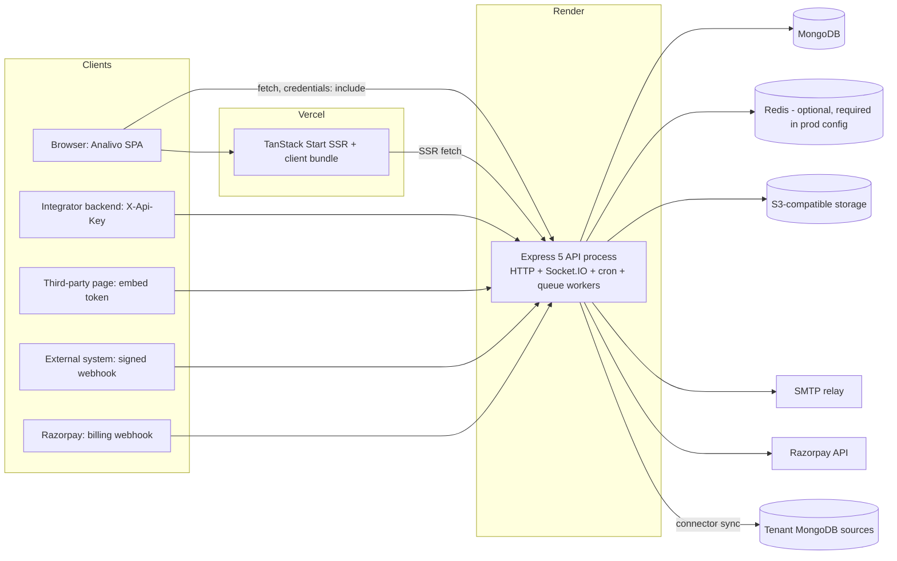

# 02. Architecture and integration map

**Audience:** engineers who need an accurate picture of how Analivo is put together today, before changing it. It describes the system as built, not as documented; where the handbook in `backend/src/docs/` says otherwise, the difference is called out.

## 1. System context

- **One backend process does everything.** HTTP, Socket.IO, the node-cron scheduler, the connector sync consumer (`backend/src/server.js:52-60`), and the analytics and export queue consumers (registered at import time in `backend/src/app.js:38-44`) all run in the same Node process. There is no separate worker service, no `render.yaml`, and nothing in the repository describes how many instances run.
- **Redis is optional in code, mandatory in production config.** Without `REDIS_URL` the cache, queues, rate-limit stores and Socket.IO adapter are in-memory and process-local. The production gate requires `REDIS_URL` to be set (`backend/src/config/env.js:372`) but the rate limiter never uses the Redis store and Socket.IO's adapter wiring was not found to be active (document 12, OPS findings).
- **Frontend and API are on different sites** (`*.vercel.app` and `*.onrender.com`). The refresh cookie is therefore cross-site and defaults to `SameSite=None; Secure` in production (`env.js:170`). Browsers that block third-party cookies break session restore; see AUTH findings.

## 2. Backend structure

### 2.1 Layers

`routes → middleware → controllers → services → repositories → models`, with infrastructure behind service wrappers (`cache.service.js`, `queue.service.js`, `storage.service.js`, `email.service.js`, `paymentProvider.adapter.js`). The layering is mostly respected; exceptions found during the audit include services importing repositories lazily inside functions (`backend/src/services/externalApi.service.js:121`) and several controllers that read `req.tenant`/`req.user._id` with the wrong shape (section 3).

### 2.2 API surfaces and their middleware chains

All routes are mounted under `API_PREFIX` (default `/api/v1`) behind a global per-IP limiter (`backend/src/app.js:135`). The table shows the chain actually present in the route files, not the one described in comments.

| Surface | Prefix(es) | Identity | Tenant context | Authorisation | Notes |
|---|---|---|---|---|---|
| Tenant workspace (most features) | `/analytics`, `/connectors`, `/dashboards`, `/reports`, `/alerts`, `/notifications`, `/invitations` | `authenticate` (user JWT + live session check) | `resolveTenant` (JWT claim authoritative; header must match) | `permission(module, action)` | e.g. `dashboard.routes.js:48` `guarded()` helper |
| Tenant workspace without tenant resolution | `/api-keys`, `/embed/tokens`, `/users`, `/access-logs`, `/compliance` | `authenticate` | **none**; controllers read `req.tenant` (undefined) or `req.user.tenantId` | `permission(...)` (none on `/users` list/get) | `/api-keys` and `/embed/tokens` are broken by this (API findings) |
| Workspace billing self-service | `/tenants/:id/...` (subscription router) | `authenticate` | `tenantIsolation` on `:id` | `permission('iam.subscriptions'...)` keys that are never seeded (TEN findings) | Only router that mounts `tenantIsolation` |
| Tenant auth | `/auth/*` | public + strict limiter | `X-Tenant-Id` slug for login/reset | n/a | |
| Platform admin | `/admin-auth/*`, `/admin/*`, `/tenants/*`, `/roles`, `/permissions`, `/monitoring`, `/support`, `/audit-logs`, `/access-requests` (admin part), `/admin/plans|subscriptions|entitlements`, `/master-data` (writes) | `adminAuth` (admin JWT + live session) | admin `tenantScope` claim for scoped support admins (enforced inconsistently) | `permission(...)`; some routes gate on `adminType` only or on `adminAuth` alone | ADM findings |
| Not implemented | `/settings/*`, `/feature-flags/*`, `/email-templates/*` | — | — | — | Return 501 |
| External API | `/external/*` | `authenticateApiKey()` (`X-Api-Key: prefix.secret`) | `req.tenant = key.tenantId` (string) | inline `requireScope` per handler | Unreachable in practice: keys cannot be created (API findings) |
| Public embed read | `GET /embed/:token` | token hash lookup | from token | token status/expiry; dashboard published | `EMBED_CORS_ALLOW_ALL` defaults to true; minting is broken (API findings) |
| Inbound connector webhooks | `POST /webhooks/:webhookToken` | none (HMAC over raw body) | from connector | signature + timestamp tolerance | raw body via `express.raw` (`app.js:120`) |
| Billing webhook | `/billing/webhook` | Razorpay signature over raw body | from subscription | n/a | `app.js:121` |
| Health | `/health`, `/health/ready` | public | — | — | readiness checks MongoDB only |

### 2.3 Cross-cutting middleware

| Concern | Implementation | State |
|---|---|---|
| Request id | `requestId.middleware.js`, echoed as `X-Request-Id` | Works server-side; the frontend neither sends nor displays it |
| Access log | `accessLog.middleware.js`, buffered writes, authenticated requests only | Works; raw tokens in URL paths are logged (OPS/API findings) |
| Security headers | `helmet()` then a custom CSP that overwrites helmet's (`app.js:64-98`) | Present; `frame-ancestors`/`form-action` lost |
| CORS | allow-list from `CORS_ORIGINS`/`CLIENT_URL`, credentials true (`config/cors.js`) | Production gate forbids `*` and localhost |
| Rate limiting | global 300/15 min per IP, strict 20/15 min shared by all auth routes, external 60/min, embed 120/min; memory store | Global limiter runs before the narrower ones; per-process only |
| Validation | dependency-free schema engine (`validators/index.js`) | Shallow: arrays/objects are accepted as-is, so nested query objects are unvalidated |
| Idempotency | `idempotency.middleware.js` | **Never mounted**, although the frontend sends `X-Idempotency-Key` on every mutation |
| Audit | model plugin + explicit `auditLog.emit` calls; request-level `audit.middleware.js` not mounted on mutating routes | Partial (GOV findings) |
| Errors | central `errorHandler`, `ApiError` factories, JSON envelope `{ success, statusCode, message, code?, errors?, meta? }` | Consistent where `ApiError` is used; plain `Error` throws become 500 |

### 2.4 Data layer

- 41 Mongoose models, 34 repositories. Shared plugins: `tenantScope`, `softDelete`, `paginate`, `optimisticConcurrency`, `audit`.
- **The `tenantScope` read filter is dormant.** It only filters when `Model.useScope()` has been called, and nothing in `src/` calls it (`backend/src/models/plugins/tenantScope.js:61-72,101-118`). Tenant isolation therefore rests on each repository adding `tenantId` explicitly and on the analytics engine's leading `$match`. Where a repository adds `tenantId` only when it is truthy (for example `apiKey.repository.js:43-44`), a missing tenant silently removes the filter. The plugin's design would also be unsafe if enabled, because the scope is stored as a static on the shared model and would leak between concurrent requests.
- **Indexes are not built in production** (`autoIndex: !isProduction`, `backend/src/config/database.js:30`) and there is no migration or index-sync tooling. Every unique constraint is therefore unenforced on a fresh production database (DB findings).
- No multi-document transactions are used; multi-step writes (registration, invitation provisioning, subscription changes) use best-effort compensation.

### 2.5 Asynchronous processing

| Work | Trigger | Executor | Durability |
|---|---|---|---|
| Connector sync | API enqueue after upload/sync request; webhook receipt | `connector.queue.js` consumer started in `server.js` | In-memory queue unless `REDIS_URL` (BullMQ); in-memory jobs are lost on restart and the connector stays `running` (CON findings) |
| Report runs, alert evaluation | node-cron every minute (`reportSchedule.job.js`, `alertEval.job.js`) → enqueue → `analytics.worker.js` | same process | No lock: every instance runs every tick |
| Audit export | API request → `export.worker.js` | same process | Artefacts never expire |
| Analytics async export | `POST /analytics/export` enqueues an `export` job | **no consumer handles it** | Broken (ANA findings) |
| Billing reconcile | cron, disabled by default | same process | |
| Anomaly, cleanup/retention, email drain, sheet sync | cron, disabled by default | **no-op stubs** | — |
| Email | Sent synchronously inside request handlers via nodemailer; the email queue consumer throws "not implemented" | — | No retry or outbox |

### 2.6 Realtime

Socket.IO is initialised with CORS but **no handshake authentication** and no domain events; nothing joins tenant rooms (`backend/src/websocket/index.js`, `events.js`). It is latent infrastructure, not a feature.

## 3. Frontend structure

| Concern | Implementation | Notes |
|---|---|---|
| Framework | TanStack Start (SSR) + TanStack Router file routes + TanStack Query, deployed on Vercel via Nitro | Lovable-generated scaffold and conventions |
| HTTP client | `frontend/src/lib/api/client.ts` | In-memory access token per audience (`tenant`, `admin`); HttpOnly refresh cookie; one refresh-and-retry on 401; `X-Idempotency-Key` on non-GET (ignored by backend); `X-Tenant-Id` only on login/password calls |
| Sessions | `frontend/src/lib/auth/session.tsx` | Separate tenant and admin providers, rebuilt on every route; tenant slug remembered in `localStorage`. The tenant profile comes from `GET /users/me`, which returns the user document **without roles or permissions** (`backend/src/services/user.service.js:42-46`) |
| Permissions | `frontend/src/lib/permissions/index.ts` | `hasPermission` **denies when the list is empty** (`:46-48`). Feature pages use it (for example `ConnectorList.tsx:70,97`), so every tenant user, including the owner, sees "Permission required" on datasets, dashboards, reports, alerts, API keys, embed and notifications ({{FE:perm-gate}}). The session object's own `hasPermission` allows an empty list, so the two helpers disagree. Unit tests mock a permissions array and do not catch this |
| Layouts | `TenantShell`/`TenantPortal`, `AdminShell`/`AdminPortal` | Two separate shells; admin and tenant navigation are distinct |
| States | `components/common/states.tsx` | Shared loading, empty, error, 501 "Coming soon" components; messages are rendered as text, never HTML |
| Error reporting | `lib/errors/*` (Lovable reporter) | No production error aggregation (OPS findings) |

## 4. Configuration and environments

See document 01 §2.3 for keys. Notable architecture-level facts: `NODE_ENV` is not pinned in any deploy artefact the repository controls; production safety gates only apply when it equals `production`; the developer `.env` is described by `scripts/ci/run-tests.js:39-41` as holding "real production credentials"; and two MongoDB timeout settings never reach the driver because of a property-name mismatch (`TimeoutMs` vs `TimeoutMS`, `env.js:147-148` vs `database.js:34-35`).

## 5. Frontend → backend → database integration map

<!-- FLOWS -->

## 6. Architectural risks summary

| Risk | Consequence | Where addressed |
|---|---|---|
| Isolation depends on per-repository discipline, not a layer | One forgotten or falsy `tenantId` becomes a cross-tenant read | Documents 14, 16; roadmap phase 1 |
| Single process, no locks, in-memory fallbacks | Scaling to two instances duplicates cron work and splits rate limits; restarts lose queued jobs | Document 12; roadmap phases 1–2 |
| Unbuilt production indexes | Unique constraints unenforced; slow queries as data grows | Document 16; roadmap phase 0 |
| Shallow validation of nested query objects | Expression injection and 500s in analytics | Documents 06, 14 |
| Frontend/backend contracts authored separately | Silent shape mismatches (grouping, lists, embed preview, admin types) | Documents 15, 17 |
| No CI | Regressions and environment drift reach `main` unseen | Document 17; roadmap phase 0 |
