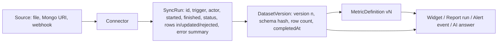

# 06. Connectors, datasets and the query engine

**Audience:** engineers working on data onboarding, ingestion and query execution.

**Summary.** CSV upload and signed-webhook ingestion are real and covered by integration tests. XLSX and external-MongoDB connectors are implemented but untested, and the MongoDB connector will connect to any host. Google Sheets and six other providers named in the code comments and handbook do not exist. Operationally the connector feature is fragile: every update, delete or sync permanently consumes a quota unit until the tenant is locked out ({{CON:quota}}); a restart during a sync leaves the connector stuck in `running` with no recovery ({{CON:wedge}}); deleting a connector leaves its rows queryable ({{CON:delete-cascade}}); and there is no scheduled refresh. The query engine enforces tenant isolation correctly on every path, but it filters dates on ingestion time instead of business time ({{ANA:date}}), accepts unvalidated nested query objects into `$expr` with no time limit ({{ANA:expr}}), and silently drops anything it does not understand ({{ANA:silent-drop}}).

In this codebase a **dataset is a connector**: rows from any connector are stored in the shared `ConnectorRow` collection keyed by `{tenantId, connectorId, sourceRowId}`, and every query, widget, report, alert and external API call reads that collection through `backend/src/services/analytics.engine.js`.

## 1. Connector inventory

| Provider | Status | Authentication | Credential storage | Ingestion | Schema discovery | Incremental | Errors and retry | Tests |
|---|---|---|---|---|---|---|---|---|
| CSV upload | **Implemented and verified** | n/a (authenticated upload) | Config (delimiter, header) AES-256-GCM encrypted | Multipart upload (10 MB, memory) → base64 in queue message → stream-parse → bulk upsert | Field names from header; sample rows; no types | No: full re-upsert per upload; removed rows never deleted | Queue retry up to 5 attempts with backoff, including permanent errors | `tests/modules/connectors/csv/*`, `tests/connectors/connector.service.integration.test.js:172-272` |
| XLSX upload | **Implemented but incompletely verified** | n/a | as CSV | ExcelJS loads the whole workbook and all rows into memory | Header row; numeric sheet index rejected by validator | No | as CSV | **None** (STATUS.md cites a test file that does not exist) |
| MongoDB (external) | **Implemented but incompletely verified** | Credentials inside the connection URI | Encrypted with `{tenantId, purpose}` context | `find(filter).limit(100000)` full read per sync | None (no preview) | No | Driver errors echoed to the tenant; no socket or job timeout | **None** |
| Inbound webhook | **Implemented and verified** | HMAC-SHA256 over raw body with per-connector secret; optional timestamp tolerance | Secret encrypted; token is 24 random bytes | Push; payload records upserted | Keys of pushed objects | Upsert by `sourceRowId` | Not gated by sync lock, no `paused` check, no stored-rows quota | `tests/modules/connectors/webhook/*`, integration test `:110-170` |
| Google Sheets | **Planned or documented only** | — | — | `sheetSync.job.js` is a no-op stub | — | — | — | — |
| PostgreSQL, MySQL, REST pull, GraphQL, Snowflake, BigQuery | **Missing** (advertised in `backend/src/connectors/BaseConnector.js:5-7` and module README) | — | — | — | — | — | — | — |

The public homepage lists only CSV, XLSX and webhooks (`frontend/src/routes/index.tsx:52-56`), which is accurate except that XLSX is untested. The backend handbook and connector comments over-claim ({{CON:advertised}}).

## 2. Bring-your-own-data assessment (brief §6.2)

| Aspect | Current behaviour | Gap and recommendation |
|---|---|---|
| File formats and limits | CSV and XLSX up to `CONNECTOR_CSV_MAX_UPLOAD_MB` (10 MB). The XLSX-specific limit is never applied. The file filter accepts `text/plain` and `application/octet-stream`, and a MIME **or** extension match ({{CON:upload}}) | Per-type validation with content sniffing; map multer errors to 413/415 instead of 500; stream XLSX rows instead of loading the workbook ({{CON:xlsx}}) |
| Database connections | MongoDB only; any URI accepted, including private ranges and cloud metadata addresses; driver errors returned verbatim ({{CON:ssrf}}) | Egress policy: resolve and deny private, link-local, loopback and metadata ranges at connect time (and re-check after DNS resolution), require TLS for non-SRV hosts, allow-list ports, generic error messages with a correlation id |
| API connections | Push only (webhook). No pull connector for REST APIs | Add pull connectors only after the job model below exists |
| Dataset creation and ownership | Creating a connector creates the dataset; owned by the tenant, no per-dataset access control | Dataset-level permissions are a later need (document 05); today any member with `analytics.view` can query every dataset |
| Schema validation and type conversion | A typed declarative `fieldMapping` exists server-side (`backend/src/modules/connectors/shared/field-mapping.js`) but the UI cannot author it; previews return names without types; rows are schemaless ({{AI:schema}}) | Persist a profiled schema per dataset version; let users confirm types and choose the business date field |
| Null and malformed values | `relax_column_count: true` silently accepts ragged CSV rows; fields come from the first sample row | Report row-level errors with counts and the first N examples per sync |
| Duplicates | `sourceRowId` is a hash of the whole record unless an `idField` is declared (and array-form mappings cannot declare one), so edited rows become new rows | Let users pick a key column; add a "replace dataset" sync mode for files |
| Large datasets | Upload buffer travels base64 inside the queue message; `MAX_RECORDS_PER_SYNC` (5,000) applies only to array payloads; MongoDB reads up to 100,000 documents with no timeout ({{CON:mongo-timeouts}}) | Stage uploads in object storage and pass a reference; stream with back-pressure; enforce row caps for every provider |
| Refresh | Manual only; no schedule field on `Connector` | Scheduled refresh after the durable job model exists |
| Deletion | Soft-deletes the connector only; rows remain and are still returned by tenant-wide queries and cached for up to 5 minutes ({{CON:delete-cascade}}) | Cascade: mark rows deleted (or hard-delete), invalidate caches, disable dependent widgets, reports, alerts and embed tokens with a visible reason |
| Quotas | `connectors` quota is incremented on every update, delete and sync and never released; `storedRows` is estimated from byte size and not applied to webhooks ({{CON:quota}}, {{CON:storedrows}}) | Count resources, not operations; reconcile from the database; atomic conditional increments |
| Export and portability | Async analytics export returns 202 but no worker handles it ({{ANA:export-broken}}); report exports are capped at one page | Fix export; add full dataset export for owners |
| Lineage and provenance | None beyond `lastSyncedAt` and `lastError` | Section 4 |

## 3. Query engine and query safety (brief §6.3)

The engine (`backend/src/services/analytics.engine.js`) turns a JSON query (filters, `filtersOp`, `dateRange`, `groupBy`, metrics, `orderBy`, pagination) into one aggregation: a leading `$match` with `tenantId` and `deletedAt: null`, then a `$facet` with the rows pipeline and a count pipeline. It is the right building block and should be kept; replacing it with a different engine is not justified by any evidence found.

### 3.1 Controls that work

- Tenant isolation: the leading `$match` always includes the caller's tenant id (`analytics.engine.js:63-75`), and every caller (analytics routes, dashboards, reports, alerts, external API, embed) passes a server-derived tenant id. Tests cover cross-tenant isolation for dashboards and reports.
- Dataset ownership: dashboard, report and alert execution verify the dataset belongs to the tenant before running (`dashboard.service.js:290-294`).
- Operator allow-list: only `eq, neq, in, nin, gt, gte, lt, lte, exists` filters and `count, sum, avg, min, max` metrics are translated.
- Page size is capped at 200 rows.

### 3.2 Gaps

| Gap | Effect | Finding |
|---|---|---|
| Date presets filter `ingestedAt`, rewritten to "now" on each sync; computed in server-local time | Time-window answers are wrong for any historical file and change after every re-sync | {{ANA:date}} |
| Filter `value` and field names are not validated; values are placed inside `$expr` | Aggregation-expression injection (CPU-heavy expressions, and `$function` where server-side JavaScript is enabled); 500s on malformed input | {{ANA:expr}} |
| No `maxTimeMS`, no cancellation, no per-tenant concurrency limit; dashboards run up to 30 widgets concurrently, also from the public embed route | One expensive query or dashboard can monopolise the database connection pool | {{ANA:expr}} |
| Unknown operators, metrics and malformed filters are dropped silently | Users receive unfiltered or mis-aggregated data with HTTP 200 | {{ANA:silent-drop}} |
| `$toDouble` on a non-numeric string aborts the whole query; range filters compare strings lexicographically | Charts fail on the first dirty cell; `"9" > "10"` | {{ANA:tostring}} |
| The analytics route returns rows as the envelope's `data` array (`backend/src/controllers/analytics.controller.js:78-94`), but the UI stores `payload.data` as `result` and reads `result.rows` (`frontend/src/features/analytics/api/index.ts:25-30`, `QueryResults.tsx:69`) | Every query on the Analytics page shows "No data matched", whatever the data | {{FE:analytics-shape}} |
| UI sends `groupBy` as strings and `orderBy.dir`; the engine expects `[{field}]` and `direction` | Grouped results from the Analytics page collapse to one row; sort direction ignored | {{AI:groupby}} |
| Query and widget caches are not invalidated on sync or delete | Up to five minutes of stale results after a refresh | {{ANA:cache}} |
| Query history stores `createdBy: null` | No audit of who ran which query | {{AI:observability}} |

### 3.3 Recommended controls

1. **Validate the full query contract** with a schema (operators, field-name pattern without `$` or `.`, scalar or array-of-scalar values, enumerated date presets, bounded array sizes) in one module used by the analytics controller, dashboards, reports, alerts and the external API; reject with 400 instead of dropping.
2. **Bound execution:** `maxTimeMS` on every aggregation, a per-tenant concurrent-query semaphore, a dashboard-level concurrency limit, and a per-tenant daily query quota recorded in usage counters.
3. **Typed numeric handling:** `$convert` with `onError: null` and report the count of non-numeric values in result metadata.
4. **Business-time filtering and bucketing** (document 08, prerequisites P1 and P5).
5. **Dataset versioning:** bump a dataset version on each completed sync and include it in cache keys.
6. **Disable server-side JavaScript** on the production cluster if the provider allows it, as defence in depth against expression injection.

## 4. Freshness, lineage and job visibility (brief §6.4)

Today the connector document carries `syncStatus`, `syncRequestedAt`, `lastSyncedAt`, `lastError` and `errorCount` (whose semantics are inverted: it counts field-level errors on successful syncs and resets on clean ones). Sync requests return no job id, there is no history of runs, and the monitoring service's queue and scheduler probes are placeholders ({{CON:no-job-history}}). If the process restarts during a sync, the in-memory job is lost and the connector stays `running`; the stale-job recovery module that was meant to handle this is dead code that would crash if imported ({{CON:wedge}}, {{CON:stale-dead}}).

**Proposed lineage model, sized to the current architecture:**

- `SyncRun` (new, tenant-scoped, TTL per retention policy) gives job identity, progress, retries and an operator-visible history. A reaper marks runs `failed` when their lease expires, which unwedges connectors.
- `DatasetVersion` is a counter plus schema hash on the connector, updated when a run completes. Every result object (widget execution, report artefact, alert event, AI answer, export) records the dataset id and version it read, so "data as of" and "computed from" can be shown and reproduced.
- The UI shows freshness (last successful sync, age) on every dataset, widget and report, and a warning when the last run failed.

## 5. Connector architecture recommendations

Keep `BaseConnector` and `ConnectorRegistry`; they are sound. Add only what the gaps require:

1. A capability descriptor per provider (`supportsPreview`, `supportsSchema`, `supportsIncremental`, `supportsSchedule`, `maxRowsPerSync`) so the UI and API offer only what a provider can do, and the registry rejects unknown types at startup.
2. A durable queue in production (BullMQ on Redis, already a dependency), a separate worker process, and a lease/claim on each connector so only one sync runs at a time across instances.
3. A permanent-versus-transient error taxonomy (already sketched in `shared/errors.js`) so configuration errors fail fast instead of retrying five times.
4. An outbound network policy shared by all pull connectors (section 2, database connections).
5. A connector roadmap driven by demand after the core is fixed. Likely order: Google Sheets (OAuth, read-only scope), PostgreSQL/MySQL (read-only role, query timeout, row cap), then a generic REST pull connector with pagination and rate-limit handling. Do not list a provider publicly until it has an integration test against a real or containerised instance.

## 6. Findings in this area

{{CON:quota}}, {{CON:wedge}}, {{CON:ssrf}}, {{CON:stale-dead}}, {{CON:storedrows}}, {{CON:webhook-scrypt}} (every webhook request runs synchronous scrypt key derivation before signature verification, a CPU amplification vector), {{CON:delete-cascade}}, {{CON:cron-lock}}, {{CON:shutdown}}, {{CON:upload}}, {{CON:xlsx}}, {{CON:mongo-timeouts}}, {{CON:no-job-history}}, {{CON:advertised}}, {{ANA:date}}, {{ANA:expr}}, {{ANA:silent-drop}}, {{ANA:tostring}}, {{ANA:cache}}, {{ANA:export-broken}}, {{AI:schema}}, {{AI:groupby}}. Full details, evidence and acceptance criteria are in `19-findings-register.md`.
