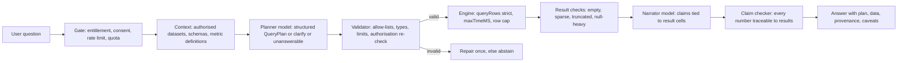

# 08. AI analytics blueprint

**Audience:** engineering and product leads deciding how Analivo should add natural-language analytics, AI insights, automatic dashboards, business health scoring and business-data anomaly detection.

**Verdict:** Analivo has **no AI capability today** ({{AI:none}}). There is no model provider, no prompt, no AI route, model, job or UI in either repository, and the only "anomaly detection" is a scheduled job that logs "stub - nothing to do" ({{AI:anomaly-stub}}). The public website correctly makes no AI claim. The existing analytics engine is a reasonable execution target for an AI planner, but several engine and data-model defects must be fixed first, because an AI layer would amplify them into confidently wrong answers.

The recommended direction is: **the model plans, the engine computes, code verifies.** The model never writes MongoDB pipelines or SQL. It emits a typed query plan against a catalogue of authorised datasets, fields and metric definitions; deterministic code validates and executes that plan through the existing engine; narratives are generated only from computed results and are checked against them before they reach the user.

## 1. Current state (verified)

| Capability (brief §8) | Status | Evidence |
|---|---|---|
| Natural-language analytics | **Missing** | No provider dependency in `backend/package.json` or `frontend/package.json`; no AI keys in `backend/src/config/env.js`; no AI route in `backend/src/routes/`; only roadmap prose in `backend/src/docs/phases/phase-6.md:30-56` ("Future, exploratory") and `backend/src/docs/03-product-roadmap.md:493-528` |
| AI-generated insights | **Missing** | `grep insight\|recommend` over `backend/src` finds only unrelated comments |
| Automatic dashboard generation | **Missing** | Widgets are hand-authored as raw JSON in `frontend/src/features/dashboards/components/DashboardEditor.tsx` |
| Business health scoring | **Missing** | No score, scorecard or KPI-target model; "health" in code means infrastructure probes (`backend/src/services/monitoring.service.js`) |
| Business-data anomaly detection | **Planned or documented only** | `backend/src/jobs/anomaly.job.js:27-30` is a no-op; disabled by default (`env.js:322-325`); no tests |
| Threshold alerts (non-AI baseline) | Implemented, with defects | `backend/src/services/alert.service.js` evaluates a threshold through the engine; see {{ANA:alert-cron}}, {{ANA:alert-metric}} |
| AI evaluation / observability | **Missing** | No invocation record; analytics query history stores `createdBy: null` (`backend/src/services/analytics.service.js:59`) |
| Public AI claims | None (correct) | `frontend/src/routes/index.tsx:141-160` lists dashboards, analytics, reports, alerts only |

## 2. Foundations that already exist and should be reused

| Asset | Where | Why it matters for AI |
|---|---|---|
| Typed query contract with tenant injection | `backend/src/services/analytics.engine.js:16-31,62-75` | The engine always prepends `{ tenantId, deletedAt: null }` to the pipeline, so any plan executed through it inherits tenant isolation |
| Whitelisted query fields for widgets, reports, alerts | `backend/src/models/Widget.js:38-46` (`QUERY_FIELDS`), `dashboard.service.js:159-172` | One contract can serve widgets, reports, alerts and AI plans |
| Provider-adapter pattern with a no-op default | `backend/src/services/paymentProvider.adapter.js` (noop/razorpay, injectable SDK factory, timeout, normalised errors), `backend/src/services/mail.transport.js` | Template for `aiProvider.adapter.js`; the no-op provider returning 501 gives honest degradation to the query builder |
| Typed field coercers | `backend/src/modules/connectors/shared/field-mapping.js:16-78` | Basis for inferring and enforcing field types |
| Entitlements and feature flags | `backend/src/services/entitlement.service.js:169-173`, `backend/src/models/FeatureFlag.js` | Gate AI by plan and roll it out per tenant |
| Usage counters | `backend/src/models/UsageCounter.js`, `backend/src/services/usage.service.js` | Meter AI calls once an AI metric exists ({{AI:metering}}) |
| Audit trail | `backend/src/services/auditLog.service.js` | Record consent changes and AI invocations |

## 3. Prerequisites: fix these before any model is connected

An AI layer that sits on today's engine would produce fluent, wrong answers. These items are prerequisites, not enhancements. Each is a finding in `19-findings-register.md`.

| # | Prerequisite | Problem today | Required outcome |
|---|---|---|---|
| P1 | **Business-time semantics** ({{ANA:date}}) | Every date preset filters `ingestedAt`, which is overwritten with "now" on every sync, and presets are computed in server-local time. "Revenue last month" on a three-year CSV returns everything or nothing. | `dateRange.field` names a typed business date column; presets resolve in the tenant's time zone; ingestion time remains available as an explicit field |
| P2 | **Typed dataset schema catalogue** ({{AI:schema}}) | `ConnectorRow.data` is schemaless; previews return names without types; result columns are derived from the current page | A persisted schema per dataset: field name, inferred type, null rate, distinct-count estimate, sample values (masked where sensitive), last profiled time, plus a `GET /connectors/:id/schema` endpoint |
| P3 | **Strict query validation** ({{AI:strict}}, {{ANA:expr}}, {{ANA:tostring}}) | Unknown operators and metrics are silently dropped (HTTP 200 with unfiltered data); field names are unvalidated; filter values are embedded in `$expr` unvalidated; there is no `maxTimeMS`; one non-numeric string aborts a `sum` | A strict mode that rejects unknown operators, unknown or `$`/`.`-containing fields and non-scalar values with 400; numeric coercion via `$convert` with `onError`; a per-query time limit and row cap |
| P4 | **Contract alignment** ({{AI:groupby}}) | The UI sends `groupBy` as strings and `orderBy.dir`; the engine reads `groupBy[].field` and `orderBy[].direction`, so grouped results collapse to one row | One shared, validated contract used by UI, API, widgets, reports, alerts and AI |
| P5 | **Time bucketing and derived metrics** ({{AI:bucketing}}) | `groupBy` groups raw values only; metrics are count/sum/avg/min/max | `groupBy: [{ field, bucket: "day"|"week"|"month"|"quarter" }]` via `$dateTrunc` with the tenant time zone; `count_distinct`; ratio metrics defined as two metrics and a divisor; period-over-period comparison computed server-side |
| P6 | **Cache coherence** ({{ANA:cache}}) | Analytics and widget caches are not invalidated after a sync | Cache keys include a dataset version bumped on every sync |
| P7 | **Attribution and provenance** ({{AI:observability}}) | Query history stores no actor | Every executed plan records actor, dataset ids and versions, time window and engine parameters |

## 4. Target architecture for natural-language analytics



### 4.1 Stages and their contracts

1. **Gate.** Requires the `ai_assistant` entitlement and feature flag, a recorded tenant consent ({{AI:consent}}), the caller's `analytics.view` permission, and an available `aiQuestionsPerDay` quota counted with a daily period ({{AI:metering}}).
2. **Context assembly (deterministic).** Lists only datasets the caller may read in their tenant. Supplies field names, types and descriptions from the schema catalogue (P2) and the tenant's metric definitions (section 4.3). Field names and sample values are tenant-controlled text and are passed as delimited, length-capped data, never as instructions ({{AI:injection}}).
3. **Planner (model).** Returns exactly one of three shapes, constrained by structured output:
   - `plan`: a `QueryPlan` (below).
   - `clarify`: one question with up to four options, for example "Which date field defines 'this month': `order_date` or `ship_date`?"
   - `unanswerable`: a reason code (`no_matching_dataset`, `missing_field`, `unsupported_operation`, `not_authorised`, `out_of_scope`) and the missing concepts.
4. **Validator (deterministic).** Rejects any dataset not in the authorised list; any field not in that dataset's schema; any operator, bucket or metric not in the allow-list; type mismatches (sum over a string field, date bucket over a non-date field); time windows beyond the plan's limit; group cardinality beyond the cap. One automatic repair round sends the validator's error list back to the planner; a second failure becomes `unanswerable`.
5. **Execution.** Runs the validated plan through `analytics.engine.queryRows` in strict mode, inheriting the tenant `$match`, with a time limit and row cap. The engine result, not the model, is the answer.
6. **Result checks.** Flags empty results, fewer than the minimum points for a trend, truncated groups, high null rates in the measured field, and stale data (dataset `lastSyncedAt` older than the window end).
7. **Narration (model, optional).** Receives the question, the validated plan, the metric definitions and the aggregated result table only, never raw rows. Returns `claims[]`, each with text and references to result cells, plus `caveats[]`. Causal wording is prohibited unless a claim is explicitly labelled as a possible explanation.
8. **Claim checker (deterministic).** Every number in the narrative must match a referenced cell within display rounding, or be a computed difference or ratio of referenced cells. Failing claims are removed; if the core claim fails, only the table and chart are shown.
9. **Response.** Shows the answer, the chart or table, an expandable "How this was calculated" panel (dataset, fields, filters, time window, time zone, metric definition and version, row count, data freshness), and feedback controls.

### 4.2 `QueryPlan` shape (illustrative)

```json
{
  "datasetId": "6650f0c2e4b0a1b2c3d4e5f6",
  "intent": "trend",
  "metrics": [{ "ref": "metric:net_revenue" }],
  "dimensions": [{ "field": "region" }],
  "time": { "field": "order_date", "bucket": "month", "range": { "preset": "last_6_months" }, "timezone": "tenant" },
  "filters": [{ "field": "status", "op": "in", "value": ["paid", "refunded"] }],
  "compare": { "type": "previous_period" },
  "limit": 50,
  "assumptions": ["'revenue' interpreted as metric net_revenue"]
}
```

The validator translates this into the engine contract after P1, P3 and P5 exist. `assumptions` are shown to the user.

### 4.3 Metric definitions ("semantic layer lite")

Column names alone do not carry business meaning; the brief explicitly warns against inferring it silently. Add a tenant-scoped `MetricDefinition` model: key, label, description, dataset, aggregation and field (or numerator and denominator for ratios), default filters, unit and format, direction (higher-is-better or lower-is-better), owner, status (`draft`/`approved`), version. Only `approved` metrics are offered to the planner by default. Metric suggestions from the schema profiler start as drafts and need a human to approve them.

Benchmark evidence supports this design: in dbt Labs' 2026 comparison, the same models answered more accurately through a governed semantic layer than by writing SQL directly (for example 90.0% versus 98.2% for one model on their test set). The figures are vendor-reported and specific to that benchmark, but the direction matches other sources, and the semantic layer also makes abstention structural: a concept that is not defined cannot be queried.

## 5. Model provider integration

| Decision | Recommendation |
|---|---|
| Adapter | `backend/src/services/aiProvider.adapter.js` modelled on `paymentProvider.adapter.js`: `{ name, isImplemented, plan(), narrate(), setSdkFactory() }`, a `noop` provider that returns 501 so the UI falls back to the query builder, a request timeout, and normalised errors that never echo payloads |
| Configuration (names only) | `AI_PROVIDER`, `AI_MODEL`, `AI_API_KEY`, `AI_TIMEOUT_MS`, `AI_MAX_OUTPUT_TOKENS`, added to `env.js` and `.env.example`, with a production gate when `AI_PROVIDER` is not `noop` |
| SDK | Official Anthropic TypeScript/JavaScript SDK (`@anthropic-ai/sdk`) behind the adapter; no OpenAI-compatible shim |
| Model | Default `claude-opus-5-5` for planning and narration, run at a low or medium `output_config.effort` for these short structured tasks. Whether a cheaper model (`claude-sonnet-5-5`, `claude-haiku-5-5`) holds quality on the planner route is a product decision to be made from the evaluation set in section 10, not assumed |
| Output constraint | Structured outputs via `output_config.format` with the `QueryPlan` JSON Schema (or a `strict: true` tool with `tool_choice: auto`). Forced `tool_choice` (`any`/`tool`) returns a 400 on current models, so do not design around it. Always run the deterministic validator anyway |
| Stop reasons | Check `stop_reason` before reading content: `refusal` (with `stop_details`) and `max_tokens` become `unanswerable` with a generic message, never a half-parsed plan |
| Caching | Keep a stable system prompt and plan schema first and the tenant's catalogue and question after the cache breakpoint, so the fixed prefix is cached across tenants and requests |
| Data minimisation | Send schemas, metric definitions and aggregated results. Do not send raw rows by default. Mask fields classified as personal data (document 11) in sample values |
| Retention and residency | Before launch, confirm the Anthropic organisation's data-retention configuration matches what Analivo promises customers, record the provider in the vendor inventory (document 11), and update the privacy policy. Note that the Fable-tier models require 30-day retention and are not available under zero data retention without Anthropic's authorisation |
| Pricing | As of the cached model table dated 2026-10-06, `claude-opus-5-5` is listed at $4 per million input tokens and $20 per million output tokens. Measure cost per answered question on the evaluation set before setting plan quotas |

## 6. Security and safety requirements

1. **Model output is data, never code.** No `eval`, no raw pipeline execution, no tool that writes data. The only executable artefact is a validated `QueryPlan`.
2. **Authorisation is re-checked after planning.** The validator re-verifies dataset ownership and the caller's permissions; the planner's choice of dataset is never trusted.
3. **Prompt injection.** Column headers, cell values, webhook keys, widget and dashboard names are tenant-controlled ({{AI:injection}}). They are passed inside a delimited data section, truncated, and cannot change the output schema. Narration sees aggregates only. Because the engine always injects the caller's tenant id, injection cannot cross tenants; the residual risk is a misleading answer, which the claim checker bounds.
4. **Abuse limits.** Per-user and per-tenant rate limits, a daily quota, a maximum question length, and a maximum number of repair rounds.
5. **Logging.** Store the plan, validator outcome, dataset ids, latency, token usage and a hash of the prompt. Store question text only under the tenant's retention policy, and never store result rows in AI logs.
6. **Kill switch.** A platform feature flag disables the route instantly; the UI falls back to the query builder.

## 7. Automatic dashboard generation

Start with a **deterministic generator**, not a model ({{AI:autodash}}):

1. Read the dataset schema (P2) and profile.
2. Classify fields: time candidates (typed dates with low null rate), measures (numeric, non-identifier, non-constant), dimensions (low-to-medium cardinality strings or booleans), identifiers (high cardinality, unique-ish) which are excluded.
3. Propose at most eight widgets: one KPI per approved metric (or per top numeric measure when no metrics exist, labelled as "suggested"), one trend line per primary measure over the chosen time field with a monthly or weekly bucket, one bar chart per top dimension, one table of recent records.
4. Show the proposal with the reason for each widget ("`amount` is numeric with 0.4% nulls; summed by month of `order_date`") and let the user remove, rename or change any widget before saving.
5. Save through `dashboard.service.createWidget` so permissions, quotas and audit apply (after fixing the quota defect {{ANA:quota}}).

A model may later be added to name widgets and write descriptions, constrained to the generator's output; it should not choose fields.

## 8. AI-generated insights

Separate **observation**, which code computes, from **explanation**, which a model may suggest.

| Insight type | Computation (deterministic) | Minimum data |
|---|---|---|
| Period-over-period change | Metric for current vs. previous comparable period, absolute and relative change | Two complete periods |
| Top movers | Dimension members ranked by absolute change contribution | Two periods, at least three members |
| Contribution analysis | Share of total change attributable to each member (additive metrics only) | Additive metric |
| Mix shift | Change in share of total by member | Two periods |
| Outlier periods | Output of the anomaly detector (section 9) | See section 9 |
| Data quality notes | Null-rate jumps, row-count drops, stale syncs | Profile history |

The narrator turns these computed facts into sentences, subject to the claim checker. Language rules: report observations as facts with their window ("Net revenue fell 12.4% in September compared with August"), label anything else as a possibility ("A possible contributor is…"), never assert causation, and always state when data is partial.

## 9. Business-data anomaly detection

This is the tenant-facing capability (brief §12.1). Platform security anomaly detection (§12.2) is a different system, covered in document 11.

**Replace the stub with a detector that chooses its method by available history,** following the progression recommended in StarTree ThirdEye's algorithm guidance (simple rules for short history, learned baselines for longer history):

| History available (per metric series) | Method | Notes |
|---|---|---|
| Fewer than 7 points or under 7 days | **No anomaly detection.** Static threshold alerts only | Show "Not enough history (n of 7 points)" instead of silence |
| 1–2 weeks | Change versus a defined baseline (same weekday last week, or trailing median) with both a relative and a minimum absolute change | Relative change alone is unstable near zero |
| 2 weeks or more with daily data | Robust seasonal baseline: rolling median and median absolute deviation per weekday; flag points outside k × MAD | MAD resists earlier outliers; k is the user's sensitivity |
| 8 weeks or more, multiple seasonality | Seasonal decomposition (STL/MSTL) on residuals | Later phase; only if the robust baseline produces too many false positives |

Requirements:

- **Inputs:** an approved metric definition, a business date field, a bucket (hour/day/week), optional dimension split (with a cardinality cap), sensitivity (low/medium/high mapped to k), direction (up, down, both), minimum absolute change.
- **Output (`AnomalyEvent`):** metric, bucket, observed value, expected value and band, deviation score, method and version, history length used, dimension values, data freshness, and a status (`open`, `acknowledged`, `dismissed`, `resolved`) with who changed it and why.
- **Operations:** runs off the scheduler with a distributed lock (document 12), is idempotent per (rule, bucket), deduplicates consecutive anomalies into one incident, and respects cooldown. It reuses the alert notification path after the alert defects are fixed ({{ANA:alert-cron}}, {{ANA:alert-metric}}).
- **Explanations:** "Orders on 14 Oct were 312; the expected range for a Tuesday was 410–520 based on the previous 8 Tuesdays." No causal claims.
- **Evaluation:** synthetic series with injected spikes, dips, level shifts and seasonal patterns (precision, recall, time-to-detect); a replay harness over anonymised or synthetic tenant-shaped data; and in-product feedback ("not an anomaly") feeding per-rule false-positive rates.

A threshold alert is not anomaly detection, and the product should not call it that.

## 10. Business health scoring

There is no universally valid business score, and the product must not invent one. Implement a **configurable scorecard** instead:

| Element | Design |
|---|---|
| Components | Tenant-selected approved metrics, each with direction, target (or acceptable band) and weight |
| Normalisation | Per component, choose one: attainment against target (capped 0–100), or position against the metric's own trailing distribution (percentile). Never compare raw values across metrics |
| Missing data | A component with insufficient or stale data is excluded and its weight redistributed; the score shows "4 of 5 components" and is marked low-confidence |
| Time window | Explicit (for example trailing 30 days versus the previous 30); shown on the score |
| Confidence | Derived from component coverage, history length and data freshness; displayed, not hidden |
| Explanation | A breakdown of each component's contribution, its raw value, target and trend |
| Versioning | Scorecard definitions are versioned; every stored score records the definition version; changing weights never rewrites history |
| Templates | Optional starting templates (for example subscription business, e-commerce) that create **draft** scorecards requiring confirmation of every metric mapping |
| Tests | Fixture tenants with known values and hand-computed expected scores, including missing-data and stale-data cases |

## 11. Evaluation and observability (brief §8.6)

**Offline evaluation set** (checked into the repository, run nightly and before any prompt or model change): synthetic datasets shaped like common tenant data (orders, subscriptions, web sessions, support tickets), each with a schema and approved metrics, and 150–300 labelled questions across categories: answerable simple, answerable with grouping or time bucketing, comparison, ambiguous (expects `clarify`), unanswerable (missing field or dataset), unauthorised dataset, prompt-injection in column names or values, and adversarial phrasing. Each item has a gold plan (or gold abstention) and a gold answer table. InfiAgent-DABench's approach of converting open questions into closed-form, automatically scorable answers is a useful model.

| Metric | Definition | Source |
|---|---|---|
| Plan validity rate | Share of plans that pass the validator without repair | Offline and online |
| Execution accuracy | Share of answerable questions whose result table equals the gold table (after normalising order and rounding) | Offline |
| Dataset-selection accuracy | Correct dataset chosen when several are authorised | Offline |
| Appropriate abstention | Precision and recall of `clarify`/`unanswerable` on the labelled ambiguous and unanswerable items | Offline |
| Groundedness / unsupported-claim rate | Share of narrative claims removed by the claim checker; target is near zero on the eval set | Offline and online |
| Unauthorised-access attempts blocked | Every unauthorised-dataset item must be refused; any pass is a release blocker | Offline |
| Latency | p50/p95 end to end and per stage | Online |
| Provider failure rate | Timeouts, 5xx, refusals per 1,000 requests | Online |
| Cost per answered question | Tokens and currency per successful answer | Online |
| User correction rate | Thumbs-down, edited plans, "this is wrong" reports per 1,000 answers | Online |

Targets should be set after a first baseline run; this audit does not invent them. Unit tests cover the validator, claim checker, and plan-to-engine translation separately from these model evaluations.

**Online records:** an `AiInvocation` model (tenant, actor, route, provider, model, effort, latency per stage, input and output tokens, validator outcome, abstention code, linked analytics query id, feedback) with a retention policy, surfaced in platform monitoring (document 12) and tenant usage (document 13).

## 12. Proposed API and data-model additions

| Addition | Purpose |
|---|---|
| `GET /api/v1/connectors/:id/schema`, `POST /api/v1/connectors/:id/profile` | Schema catalogue (P2) |
| `MetricDefinition` model and `/api/v1/metrics` CRUD (approve/version) | Semantic layer (4.3) |
| `POST /api/v1/ai/questions`, `GET /api/v1/ai/questions/:id`, `POST /api/v1/ai/questions/:id/feedback` | Natural-language analytics |
| `POST /api/v1/dashboards/generate` (returns a draft, does not save) | Automatic dashboards |
| `AnomalyRule`/`AnomalyEvent` (or `AlertRule.type = 'anomaly'` with a separate event model) and acknowledgement endpoints | Anomaly detection |
| `HealthScorecard` (versioned) and `HealthScore` snapshots | Health scoring |
| `AiInvocation` model; tenant AI settings with consent fields; `aiQuestionsPerDay` usage metric; `ai_assistant` entitlement key | Governance, metering, gating |

## 13. Phasing (detail in document 20)

| Phase | Scope | Exit criteria |
|---|---|---|
| A0 – Engine correctness | P1, P3, P4, P6 and the alert defects | Business-date presets in tenant time zone; strict mode rejects invalid plans with 400; contract tests pass for UI and API shapes; cache invalidates on sync |
| A1 – Catalogue | P2, P5, metric definitions, attribution (P7) | Schema endpoint returns typed fields after CSV/XLSX sync; monthly bucketing works; approved metrics usable in widgets |
| A2 – Ask a question (read-only) | Provider adapter, gate, planner, validator, execution, provenance panel, offline eval set | Eval baseline recorded; zero unauthorised passes; plan shown to user before or with results |
| A3 – Narration and insights | Deterministic insight computations, narrator, claim checker | Unsupported-claim rate measured and reviewed; causal-language lint in place |
| A4 – Anomaly detection | Detector, events, acknowledgement, evaluation harness | Synthetic precision/recall reported; "not enough history" state visible |
| A5 – Health scorecards | Scorecard model, UI, versioning, fixtures | Fixture scores match hand calculations |
| A6 – Automatic dashboards | Deterministic generator with review step | Generated drafts saved only after user confirmation |

## 14. Claims to avoid until shipped

Do not describe Analivo publicly as "AI-powered", "predictive", or as offering "anomaly detection", "insights", or a "health score" until the corresponding phase has passed its exit criteria. The current homepage is compliant; keep it that way.

## Sources

- dbt Labs, "Semantic layer vs. text-to-SQL (2026)": https://docs.getdbt.com/blog/semantic-layer-vs-text-to-sql-2026
- "Semantic Layers for Reliable LLM-Powered Data Analytics" (arXiv 2604.25149): https://arxiv.org/pdf/2604.25149
- InfiAgent-DABench (arXiv 2401.05507): https://arxiv.org/pdf/2401.05507
- Databricks guidance on evaluating grounded agents: https://answers.databricks.com/evaluating-ai-agents-grounded-internal-knowledge
- StarTree ThirdEye anomaly detection algorithms: https://docs.startree.ai/thirdeye/concepts-data-alerts-notifications/concepts-anomaly-detection-algorithms
- Dynatrace seasonal baseline: https://docs.dynatrace.com/docs/platform/davis-ai/ai-models/seasonal-baseline
- Sling anomaly detection (minimum history gating): https://docs.slingdata.io/sling-platform/platform/monitors/anomaly-detection
- Anthropic Claude API reference bundled with Claude Code (model table cached 2026-10-06; structured outputs, stop reasons, retention notes)
